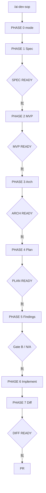

# 00 — 总览与流程图

> 给人读的入口。Agent 以 [`skills/ai-dev-sop/`](../skills/ai-dev-sop/SKILL.md) 为准。  
> **员工开发**：先看 [`节点交付物.md`](./节点交付物.md)。

## 1. 这是什么

| 问题 | 做法 |
|------|------|
| 需求不完整 | L1 + DoR |
| 迭代无切片 | Gate M（MVP） |
| 内部结构不清 | Gate D（架构图） |
| 只批口头不留痕 | **节点交付物进仓** |
| 直接上生产 | 哨兵 + G0–G3 |

启动：INTENT-raw → INTENT → `/ai-dev-sop`。

## 2. 总流程

## 3. 三层制品

| 制品 | 看见 |
|------|------|
| MVP | 交付面 |
| ARCHITECTURE | 内部结构 |
| PLAN | 文件级落地 |

## 4. 文档地图

| 层级 | 人读 |
|------|------|
| 交付物 | [节点交付物](./节点交付物.md) |
| L0 | [心智与禁区](./L0-心智与禁区.md) |
| L1 | [需求澄清](./L1-需求澄清.md) |
| L2 | [开发执行](./L2-开发执行.md) |
| L3 | [评审发布](./L3-评审发布.md) |

## 5. 哨兵句

`SPEC` → `MVP` → `ARCH` → `PLAN` → `FINDINGS` → `DIFF`（均为 `… READY — waiting for approval`）。
