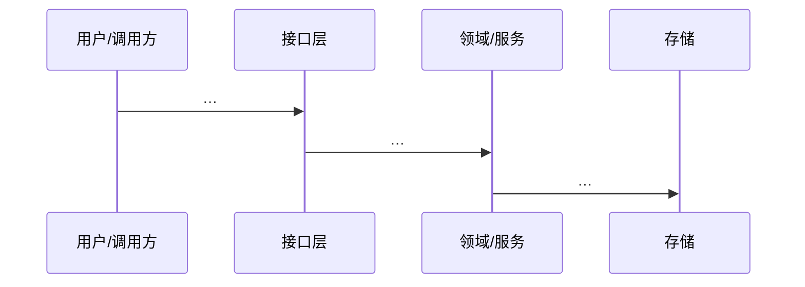

# ARCHITECTURE: <与 SPEC 相同标题>

| 字段 | 值 |
|------|-----|
| Spec ID | SPEC-… |
| MVP 引用 | SPEC §2.4 或 MVP-… |
| 状态 | draft \| ready \| approved \| N/A \| skipped |
| mode | feature \| greenfield |
| 作者 | |
| 日期 | |
| 批准人 | |
| 批准日期 | |

> 复制到 `docs/specs/ARCHITECTURE-<slug>.md`。  
> **MVP = 交付面；本文件 = 内部结构。**  
> Gate D 清单：`skills/ai-dev-sop/references/checklists/gate-d-arch.md`

---

## 0. N/A / Skip（若适用）

| 类型 | 填写 |
|------|------|
| N/A 理由 | （单文件无边界变化等；否则删本节） |
| Skip 理由 | （仅热修；否则空） |

若非 N/A/Skip，以下各节必填（增量架构可只画变更部分）。

---

## 1. 上下文与范围

- 支撑的 Ship-now（摘要）：
- 明确不在本架构内（Defer / 非目标）：

---

## 2. 逻辑视图（模块）

> mermaid 或等价图；框 = 模块/包；箭头 = 调用或依赖。


| 模块 | 职责 | 本迭代是否改 |
|------|------|--------------|
| | | Y/N |

---

## 3. 数据流 / 关键路径



---

## 4. 数据与存储（变更）

| 实体/表/集合 | 变更 | 迁移？ | 敏感？ |
|--------------|------|--------|--------|
| | 新增/改字段/无 | Y/N | Y/N |

---

## 5. 外部依赖

| 系统 | 方向 | 契约 | 失败策略 |
|------|------|------|----------|
| | in/out | | |

---

## 6. 关键决策（ADR 摘要，≥1 或 N/A）

| ID | 决策 | 选项 | 选择 | 若错的代价 |
|----|------|------|------|------------|
| D1 | | | | |

---

## 7. 风险与约束

- 性能/安全/合规约束：
- 与现有架构冲突点：
- G3 相关：无 / 有 → 升级审批

---

## 8. 与 Plan 的衔接

Plan 必须落在本架构已声明的模块/边界内；超出先改 ARCH 并再批。

**批准记录：**

```text
批准人:
日期:
语句: 批准本架构（或批准 N/A）
```
