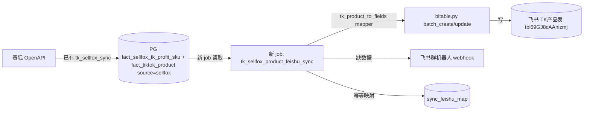
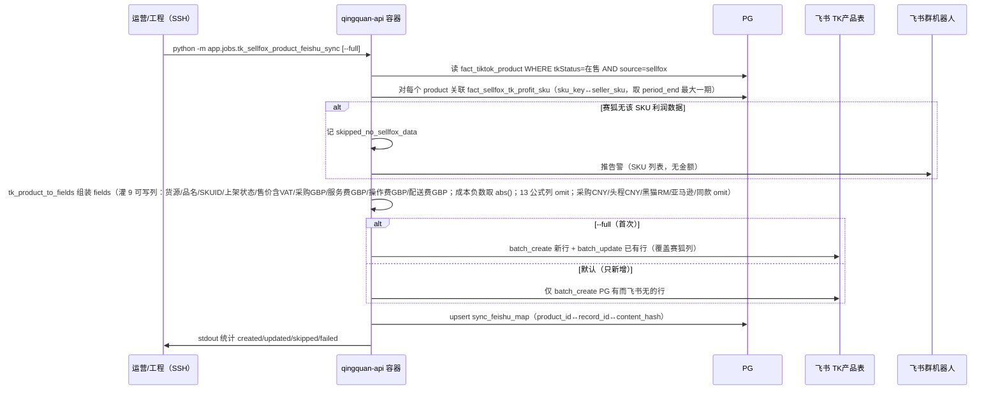

# ARCHITECTURE: TK产品表赛狐→PG→飞书同步

| 字段 | 值 |
|------|-----|
| Spec ID | SPEC-20260817-tk-sellfox-product-sync |
| MVP 引用 | SPEC §2.4（已批准 2026-08-17） |
| 状态 | approved（v2） |
| mode | feature |
| 作者 | Claude（代拟） |
| 日期 | 2026-08-17 |
| 批准人 | 用户（口头批准 v2） |
| 批准日期 | 2026-08-17 |

> 本文件 = 内部结构（增量架构）。MVP = 交付面。
>
> **v2 修订（2026-08-17 PHASE 4 Explore 后）：** 飞书表 13 列是 Formula 类型（API 写不进），原 v1「赛狐灌 ~12 列」修正为「赛狐灌 9 可写列」。详见 `EXPLORE-20260817-tk-sellfox-product-sync.md`。此为边界变更，按 SOP 回 PHASE 3 重新过 Gate D。

---

## 0. N/A / Skip

不适用 N/A。本功能新增 1 个同步 job + 1 个 mapper + 配置接入，触及飞书写入与 `sync_feishu_map` 幂等机制，需明确边界。

---

## 1. 上下文与范围

- **支撑的 Ship-now（摘要）：**
  1. 新建飞书同步 job：PG 赛狐产品+利润 → 飞书 TK产品表
  2. 首次全量 vs 只新增两模式
  3. 公式列不写值 + 手填列不覆盖
  4. 缺数据记日志 + 群告警
  5. `.env` + `store-tables.json` 配置接入

- **明确不在本架构内（Defer / 非目标）：**
  - cron 定时调度（手动触发）
  - 前端按钮 / HTTP 接口（不加 tk_ops 路由）
  - 亚马逊同款售价、黑猫RM 自动采集
  - CNY 列自动填充
  - 赛狐 vs TK后台双源对账
  - 改飞书表结构（28 列不动）
  - 不改 `tk_feishu_sync.py` 现有日表同步框架、不改 `tk_sellfox_sync.py` 现有 PG 同步逻辑

---

## 2. 逻辑视图（模块）



| 模块 | 职责 | 本迭代是否改 |
|------|------|--------------|
| `backend/app/jobs/tk_sellfox_sync.py` | 赛狐→PG（已有） | N（不改，只读其产出） |
| `backend/app/jobs/tk_sellfox_product_feishu_sync.py` | **新**：PG 赛狐→飞书 TK产品表 | **Y（新建）** |
| `backend/app/adapters/feishu/bitable.py` | 飞书 token + batch_create/update + mapper 函数集 | Y（加 1 个 `tk_product_to_fields` 函数） |
| `backend/app/config.py` | Settings | Y（加 `feishu_bitable_table_tk_product` 字段） |
| `config/feishu-tk-store-tables.json` | 分店表映射 | Y（tables 段加 `tk_product` key，三店同 table_id `tbl69GJ8cAAhizmj`） |
| `.env`（服务器） | 配置 | Y（加 `FEISHU_BITABLE_TABLE_TK_PRODUCT=tbl69GJ8cAAhizmj`） |
| `backend/app/jobs/tk_feishu_sync.py` | 日表同步框架 | N（不复用其窗口框架，见决策 D1） |
| `sync_feishu_map` 表 | 幂等映射 | Y（新增 `table_key='tk_product'` 行，key=product_id） |
| `tk_ops.py` / 前端 | HTTP 接口 | N（手动触发，不加路由） |

---

## 3. 数据流 / 关键路径



---

## 4. 数据与存储（变更）

| 实体/表/集合 | 变更 | 迁移？ | 敏感？ |
|--------------|------|--------|--------|
| `sync_feishu_map` | 新增 `table_key='tk_product'` 行（key=product_id text，非 uuid） | N（复用现有表，`local_id` 用 `gen_random_uuid()` 占位或扩展为 text） | N |
| `fact_tiktok_product` | 只读 | N | N（主数据） |
| `fact_sellfox_tk_profit_sku` | 只读 | N | Y（财务金额） |
| 飞书 TK产品表 | 写（create/update） | N | Y（财务账本） |

**注：** `sync_feishu_map.local_id` 现为 uuid 类型（日表用 fact 行 id）。product 同步的关联键是 `product_id`（text）。决策 D2 处理此不匹配。

---

## 5. 外部依赖

| 系统 | 方向 | 契约 | 失败策略 |
|------|------|------|----------|
| 赛狐 OpenAPI | in（间接，经 PG） | `docs/TK-赛狐数据源对照.md` | 本 job 不直连；PG 缺数据→记日志告警 |
| PG `tk.fact_*` | in | 现有 schema（018 迁移） | product/profit_sku 无 sellfox 数据→中止+提示先跑 tk_sellfox_sync |
| 飞书 Bitable | out | `bitable.py` + records API | batch 失败→failed 计数+日志，不回滚成功行 |
| 飞书群机器人 | out | `FEISHU_BOT_WEBHOOK_TK_HEALTH` | webhook 空→只落日志 |

---

## 6. 关键决策（ADR 摘要）

| ID | 决策 | 选项 | 选择 | 若错的代价 |
|----|------|------|------|------------|
| D1 | 新 job 是否复用 `tk_feishu_sync.py` 窗口同步框架 | A.复用日表框架 / B.独立 job 照 `tk_sellfox_sync` 全量快照模式 | **B** | 产品表是当前在售快照非日表，无 biz_date；A 强套会引入伪日期窗口 |
| D2 | `sync_feishu_map` 幂等 key 如何处理 product_id(text) vs local_id(uuid) | A.扩 local_id 为 text / B.gen_random_uuid 占位 / C.job 内自管 record_id 缓存 | **C**（Explore 已确认） | 产品表小（173行）、只新增为主，自管 `product_id→record_id` dict 从飞书现读；避免改 map 表 schema 触及日表同步 |
| D3 | product mapper 放 `bitable.py` 还是新 job 内 | A.加到 `bitable.py` / B.放 job 内私有 | **A** | A 符合现有 9 个 mapper 同构，可测；B 割裂 |
| D4 | 赛狐费用键→飞书列名映射范围 | A.原 v1 的 ~12 列 / B.**Explore 修正的 9 可写列** | **B** | 飞书 13 列是 Formula 写不进；赛狐实际灌：货源/品名/SKUID/上架状态/售价含VAT（5 Text/Number）+ 采购GBP/服务费GBP/操作费GBP/配送费GBP（4 Number）。13 公式列飞书自算 |
| D5 | profit_sku 区间汇总→飞书「单值」取哪期 | A.取 period_end 最大一期 / B.取最近 N 天聚合 | **A** | 现网 profit_sku 只有单一 period（2026-07-08..08-06），退化为取唯一期；未来多期时取 period_end 最大 |
| D6 | **公式列不可写如何处理**（Explore 新增） | A.改 Formula 为 Number / B.只灌 Number 入参让公式自算 / C.跳过公式列 | **B** | Explore 倒推确认：13 公式列入参 = 售价含VAT+采购GBP+头程CNY+配送费GBP+服务费GBP+操作费GBP+率常量。赛狐灌 5 个 Number 入参后公式自动重算。A 改表结构违反 Out of Scope；C 会让公式列失值 |
| D7 | 赛狐成本负数→飞书正数口径 | A.原值灌（负数）/ B.取绝对值 / C.取负 | **B** | profit_sku `purchaseFee`=-4.81（冲减口径），飞书 `采购GBP`=3.56（正数成本），公式 `商品总成本=采购+头程+配送` 用正数。灌 abs() |
| D8 | product 两批记录（TK采集174 + 赛狐140）去重 | A.优先 source=sellfox / B.按 product_id 去重优先在售有sku / C.两批都灌 | **B** | 按 product_id 去重，优先 status=在售 且有 seller_sku；PHASE 6 核实两批是否真同 product_id 重复 |

---

## 7. 风险与约束

- **性能/安全/合规约束：**
  - 财务金额（采购/头程/佣金/毛利）属敏感——不进群告警/Prompt/日志明文（告警只 SKU 列表）
  - 赛狐 secret 不进日志
  - 173 行级，秒级完成，无性能压力
- **与现有架构冲突点：**
  - `sync_feishu_map.local_id` 为 uuid，product_id 为 text（D2 处理）
  - `tk_feishu_sync` 窗口框架不适配商品快照（D1 选独立 job 规避）
- **G3 相关：** 财务金额写入飞书属 G3 边界（非结算/支付/凭据，但属财务数据）——SPEC 批准时用户已确认首次覆盖手填 GBP 成本列可接受；金额不外泄。**无需升级审批**，但实现时严守「金额不进告警/Prompt」。

---

## 8. 与 Plan 的衔接

Plan 必须落在本架构已声明的模块/边界内：
- 新建 `backend/app/jobs/tk_sellfox_product_feishu_sync.py`
- `bitable.py` 加 `tk_product_to_fields`
- `config.py` 加 `feishu_bitable_table_tk_product` 字段
- `config/feishu-tk-store-tables.json` tables 段加 `tk_product`
- 服务器 `.env` 加 `FEISHU_BITABLE_TABLE_TK_PRODUCT`
- PHASE 4 Explore 必须核实：D2（map 表复用方式）、A1/A4（赛狐费用键→飞书列名、sku_key↔SKUID 对齐）、A2（飞书公式入参列名）

超出先改 ARCH 并再批。

**批准记录：**

```text
批准人: 用户
日期: 2026-08-17
语句: 批准本架构（v2，Explore 后修订；v1 同日先批，Explore 发现 13 Formula 列不可写后回阶段修订重批）
```
