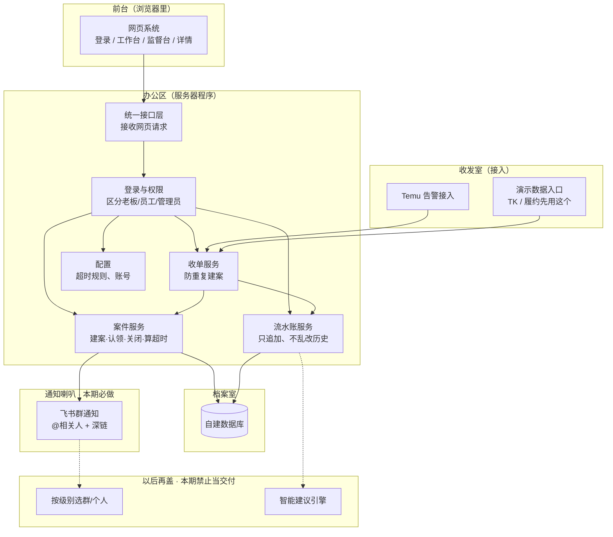
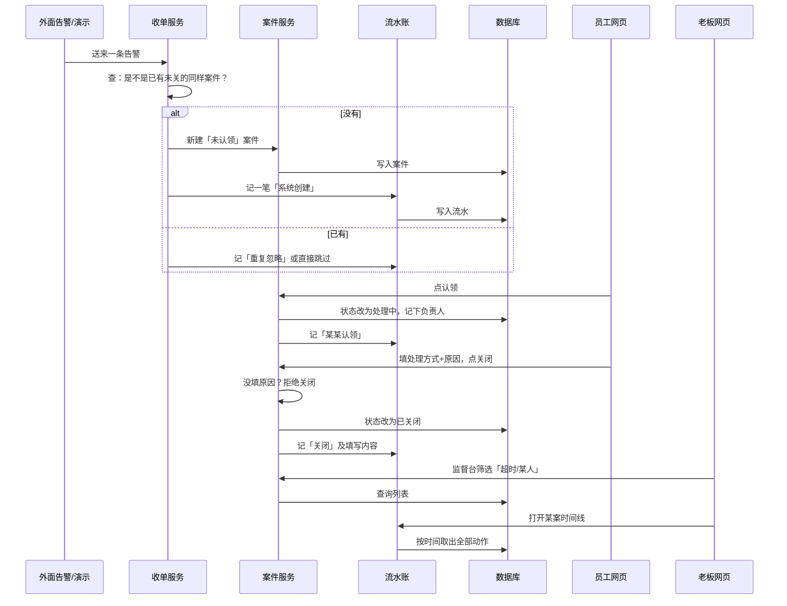

# 架构说明（中文白话版）— 清泉运营工作系统 1.0

| 字段 | 值 |
|------|-----|
| 对应需求 | SPEC-20260728-qingquan-work-os |
| 对应 MVP | `docs/specs/MVP-qingquan-work-os.md` |
| 状态 | ready（待你批准） |
| 日期 | 2026-07-28（修订：飞书群通知本期必做；推荐仍不做） |

> **这篇讲「房子怎么盖」：分成哪些房间、水管怎么走、数据存在哪。**  
> MVP 讲「住人后能干什么」；本篇讲「为了干那些事，内部怎么搭」。  
> 专有名词第一次出现都会用白话解释。

---

## 0. 先看总图（整栋楼长什么样）

用生活类比：

| 零件 | 类比 | 干什么 |
|------|------|--------|
| 网页界面 | 前台大厅 | 员工工作台、老板监督台、案件详情 |
| 业务服务（后端） | 办公室办事员 | 建案、认领、关闭、算有没有超时 |
| 接入适配器 | 收发室 | 把 Temu 告警等「外面的消息」翻译成统一案件 |
| 数据库 | 档案室 | 永久（长期）存放案件和谁做了什么 |
| 飞书群 | 大门口喇叭（**本期必装**） | 群里喊「有新单/超时」并 @该处理的人；**不是档案室** |
| 智能建议 | 未来的顾问室 | **这期不建**，只把档案格式留好（先攒数据） |

```text
【外面】Temu监测 / 演示数据发生器
           │
           ▼
      【收发室】接入适配器（翻译成统一格式）
           │
           ▼
      【办公室】业务服务：建案、认领、关闭、算超时
           │
     ┌─────┴─────┐
     ▼           ▼
【档案室】    【喇叭】飞书群通知
 数据库        @相关人 + 深链回平台
     ▲
     │
【前台大厅】网页：工作台 / 监督台 / 详情
```

**和市面跨境系统的差别（架构上也要守住）：**  
档案室里重点存的是「人做了什么」，不是再抄一份完整平台报表。

---

## 1. 本架构要撑住什么、故意不撑什么

### 1.1 必须撑住（对应 MVP 五件事）

1. 案件能建、能改状态、关闭时能留下处理方式与原因  
2. Temu 告警能进来（真接或演示）；TK/履约能用来演示同款案件  
3. 员工网页能认领/关闭  
4. 老板网页能按人/店/超时看  
5. 任意案件能看到时间线（谁、何时、做了啥）  
6. **飞书群能收到新建/超时通知，并 @到该处理的人（带平台链接）**

### 1.2 故意不放进这栋楼（避免盖成巨无）

| 不做 | 原因 |
|------|------|
| 完整 ERP / 广告投放中台 | 市面已有，不是我们差异化 |
| 飞书多维表当主数据库 | 飞书只做通知喇叭，不做档案室 |
| 智能建议、自动改广告/自动发货 | 先攒过程数据；推荐以后再做 |
| 按通知级别选「群 or 个人」 | **下版做**；本期固定走群 |
| 监控员工键鼠 | 我们做的是「案件是否超时」，不是监控桌面 |
| 改海外仓自动下单成功流程 | 太危险；本系统只接「需要人处理」的例外 |

---

## 2. 系统拆成哪些「房间」（模块说明）

下面每个名字都是内部模块；你可以把它理解成「专职岗位」。



### 2.1 每个房间干什么（请逐条看）

| 模块（白话名） | 负责什么 | 本期做不做 |
|----------------|----------|------------|
| **网页系统** | 你看到的四个屏；按钮点下去调用后面接口 | 做 |
| **统一接口层** | 网页和服务器之间的「窗口」；外面不直接改数据库 | 做 |
| **登录与权限** | 王运营只能进工作台；李总能进监督台；乱访要拦住 | 做 |
| **案件服务** | 案件生命周期：新建→认领→关闭；到点算不算超时 | 做 |
| **流水账服务** | 每一步动作记一笔「谁+何时+做了什么」，**只许追加，不许偷偷改历史** | 做 |
| **收单服务** | 外面告警进来时：查重 → 该新建还是忽略 | 做 |
| **Temu 告警接入** | 把现有 Temu 监测结果翻译成「标准收单格式」 | 做（真源或演示） |
| **演示数据入口** | 一键造 TK/履约案件，方便演示同一种模型 | 做 |
| **配置** | 超时规则、用户角色、**飞书群 Webhook、店铺→群/责任人映射** | 做 |
| **飞书群通知** | 新建案/超时推到群；@该处理的人；带平台链接；记发送成功/失败 | **做（必做）** |
| **按级别选群/个人** | 紧急个人、普通群等 | **下版** |
| **智能建议引擎** | 根据历史推荐怎么处理 | **本期禁止**（只攒数据） |

### 2.2 为什么选「一个整体程序」，而不是一上来微服务？

| 方案 | 含义 | 我们选 |
|------|------|--------|
| 微服务 | 每个房间单独一台服务，运维复杂 | 否 |
| **模块化单体** | 程序可以打成「一个后端 + 一个前端 + 一个数据库」，但代码里房间边界清楚，以后好拆 | **是** |

对你们这种传统公司起步数字化：先跑起来、边界清楚，比一上来分布式更合适。

### 2.3 代码大概怎么分文件夹（给以后开发看）

```text
apps/web/          网页前台
apps/api/          后端办公室（案件/流水/收单/权限都在这，按文件夹分清）
adapters/temu/     Temu 收发室
adapters/fixture/  演示数据入口
deploy/            怎么在服务器上启动（例如一键起数据库+服务）
docs/specs/        需求与本架构文档
```

---

## 3. 一件事从进门到关掉，系统内部怎么走

### 3.1 流程图（按时间顺序）



### 3.2 对照员工实际操作（帮助非技术同学）

1. 告警进收发室 → 档案室多了一份「未认领」卷宗  
2. 员工点认领 → 卷宗封面写上「王运营」，并盖「处理中」  
3. 员工每写一句备注 → 流水账多一页（不能撕掉改历史）  
4. 员工关闭 → 必须写「怎么处理的 + 为什么」→ 封面变「已关闭」  
5. 老板打开监督台 → 不是去 Temu 后台盯，而是看卷宗有没有超时、谁名下还有多少  

### 3.3 「超时」在内部怎么判断（白话）

建案时就算好两个截止时间：

- **认领截止时间** = 创建时间 + 该类默认小时数  
- **关闭截止时间** = 创建时间 + 该类默认小时数  

老板打开监督台时：若还没关闭，且当前时间已经过了截止时间 → 打上「超时」。  
（不必单独再做一个半夜跑批的小程序；查询时算即可。）

---

## 4. 档案室里到底存什么（数据说明）

### 4.1 四张主表（先记名字）

| 表名（可当档案柜标签） | 存什么 | 人话例子 |
|------------------------|--------|----------|
| **用户表** | 谁能登录、是老板还是员工 | 王运营 / 李总 |
| **案件表** | 每一件事的当前状态与关闭时填的内容 | 「A-1024 下架」处理中 |
| **过程流水表** | 这件事上发生过的每一步（只增不改） | 08:02 创建；08:18 王认领… |
| **超时规则表** | 每种案件默认几小时 | Temu 认领 4h / 关闭 24h |
| **通知配置表** | 哪个店铺/类型进哪个飞书群、群机器人地址、默认 @ 谁 | Agnis→运营群A |

### 4.2 案件表：一张「卷宗封面」有哪些栏

| 栏位（中文） | 干什么 | 举例 |
|--------------|--------|------|
| 案件编号 | 唯一编号 | C-20260728-001 |
| 案件类型 | Temu告警 / TK风险 / 履约例外 | Temu告警 |
| 来源键 | 用来防重复（同一商品同一天同类问题） | Agnis + SKU A-1024 + 下架 |
| 状态 | 未认领 / 处理中 / 已关闭 | 处理中 |
| 店铺 | 哪家店 | Agnis |
| 负责人 | 谁认领了 | 王运营 |
| 平台背景摘要 | 只读：在售数变化、花费等（**不是密码**） | 128→121 |
| 处理方式 | 关闭时选 | 误报 / 已恢复… |
| 原因说明 | 关闭时必填的人话 | 「季节性下架，已核对」 |
| 结果标签 | 关闭结果分类 | 已解决 / 可忽略… |
| 是否误报 | 是/否 | 是 |
| 认领截止 / 关闭截止 | 用来打超时 | 今天 12:02 前须认领 |
| 创建时间 / 关闭时间 | 审计 | |

### 4.3 过程流水表：一页「不可撕掉的记录」

每一行至少有：

- 哪条案件  
- 什么时间  
- 谁干的（系统 或 某人）  
- 动作类型：创建 / 认领 / 备注 / 改派 / 关闭 / 重复忽略  
- 补充说明（JSON 或文本）  

**规矩：只许往后加页，不许改以前那页。**  
这样才能以后做「学习老人怎么处理」（C），也才能让老板信复盘。

### 4.4 绝对不准进档案室的东西

- Temu/TikTok/赛狐的登录密码、Cookie、API 密钥  
- 没必要的完整买家姓名+详细地址（履约例外只留订单号/异常摘要即可）  

这些仍放在现有采集程序自己的安全配置里，本系统**不接过来存**。

---

## 5. 和外部系统怎么打交道

| 外部东西 | 关系 | 本期怎么处理 | 挂了怎么办 |
|----------|------|--------------|------------|
| 现有 Temu 监测 | 它产生告警，我们收 | 做「翻译器」接进来；接不上就用演示数据 | 演示仍可走通认领关闭 |
| TikTok 日报/风险 | 以后真接 | 本期用演示入口造同类案件 | 不影响 MVP 演示 |
| 海外仓桥（失败/无渠道/对账） | 只要「需要人处理」的信号 | 本期演示入口；**禁止**本系统去点自动发货 | 同上 |
| 飞书群 | **通知喇叭（必做）** | 群机器人 Webhook（或应用发群消息）；@相关人 | 发送失败记日志，**不挡**建案/关闭；站内仍能办 |
| 自建数据库 | 我们自己的档案室 | 必须有 | 没有则系统不能上 |

---

## 6. 几个关键选择（为什么这样定）

| 编号 | 我们纠结过什么 | 最后选择 | 用大白话说 |
|------|----------------|----------|------------|
| 1 | 一上来拆很多微服务吗？ | **先一个整体后端** | 人少、先跑通 |
| 2 | 数据存在飞书还是自己库？ | **自己数据库**；飞书只做群通知 | 飞书不是档案室，但是**必装喇叭** |
| 3 | 员工操作记在可改字段里还是流水账？ | **流水账只追加** | 才能复盘、才能以后学习 |
| 4 | TK/仓第一刀就接生产吗？ | **先演示数据** | 先证明「同一种案件模型」；Temu 优先真接 |
| 5 | 第一刀就做智能建议吗？ | **不做，只留字段攒数据** | 与业务确认一致 |
| 6 | 飞书怎么通知？ | **本期固定走群 + @人** | 按级别选群/个人 → 下版 |
| 7 | 界面几个主要页面？ | **说明/登录、工作台、监督台、详情** | 与原型一致 |

---

## 7. 风险（盖房时要注意的）

| 风险 | 会怎样 | 怎么防 |
|------|--------|--------|
| 员工不回系统填关闭 | 监督台失真，老板不信 | 关闭强制填原因；制度要求「不在系统关闭不算完成」 |
| 一上来接太多真源 | 半年还演示不了 | MVP：Temu 优先，其余演示 |
| 误做成又一个数据大屏 | 差异化丢失 | 评审时盯「有没有认领/关闭/时间线」 |
| 碰到发货自动写入 | 可能错发货（高风险） | 架构禁止；只读例外信号 |
| 太早做智能建议 | 乱建议、员工反感 | 本期无此模块、无此按钮 |

---

## 8. 以后开发计划必须守的边界

开发任务**只允许**动：网页、后端案件/流水/收单/权限、Temu 接入、演示入口、部署。  

若有人要加：「智能建议」「飞书当主库」「系统自动发货/改预算」「本期就做个人私聊路由」→ **必须先改这篇架构并再请你批准**，不能偷偷做。

### 飞书通知（本期）怎么实现（白话）

1. 管理员配置：群 Webhook（或应用凭证）+「店铺/案件类型 → 哪个群」+「默认 @ 哪些人（飞书用户映射）」  
2. 案件新建成功 → 通知模块组一条消息发到群 → 失败写入 `notify_logs`（或流水 activity=notify_failed）  
3. 超时检查（查询时或定时扫）发现超时 → 再发群提醒（可做简单防刷：同一案同一小时不重复吼）  
4. **下版：** 案件带 `notify_level`（如普通/紧急），路由到群或个人  

---

## 9. 你看完后建议确认的三句话

1. **同意**「档案室=自己库；喇叭=飞书群（本期必做）」吗？  
2. **同意**「本期只走群通知；按级别选群/个人放下一版」吗？  
3. **同意**「智能推荐先不做，只攒处置数据」吗？  

---

## 批准栏

```text
批准人:
日期:
语句: 批准本架构
```
