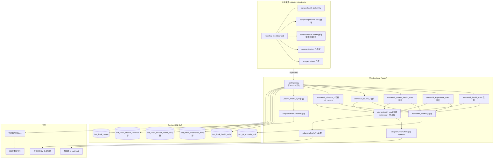
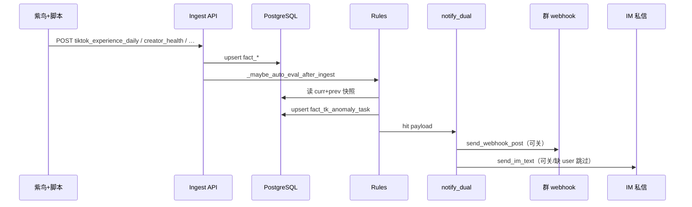
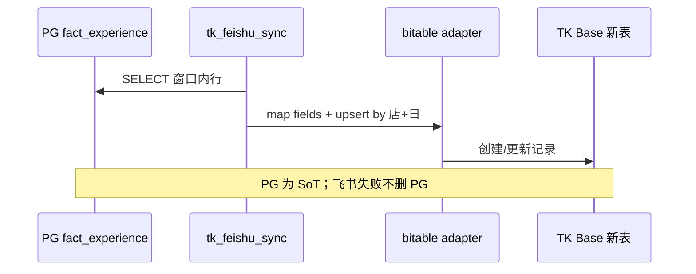

# ARCHITECTURE: TK 店铺健康/体验/达人 飞书双通道提醒与体验分进表

| 字段 | 值 |
|------|-----|
| Spec ID | SPEC-20260811-tk-shop-health-notify |
| MVP 引用 | `docs/specs/MVP-tk-shop-health-notify.md`（**已批准**） |
| 状态 | approved |
| mode | feature（**增量架构**） |
| 作者 | Grok |
| 日期 | 2026-08-11 |
| 批准人 | 用户 |
| 批准日期 | 2026-08-11 |

> 相对现网清泉中台的**增量**设计，非 greenfield。  
> MVP = 交付面；本文 = 内部结构。Gate D。

---

## 1. 上下文与范围

### 1.1 支撑的 Ship-now（M1–M5）

| MVP | 架构如何支撑 |
|-----|----------------|
| **M1** 体验分+三模块→PG→飞书新表 | 新采集模块 + 新 fact 表 + ingest source + bitable mapper + sync 任务 |
| **M2** 达人健康多账号+违规 | 采集循环切换账号 + creator 维度 fact + 规则/异常码 |
| **M3** App 私信宋敏 | 新 `feishu.im` 适配器；与 webhook 并列 |
| **M4** 双通道接到全部告警 | 统一 `notify_dual_channel()`；健康/体验/达人/差评/违规规则出口收敛 |
| **M5** 全 config 店+失败隔离 | 扩展 `run-shop-modules*.ps1` 模块列表；逐店 try/catch 既有模式 |

### 1.2 本架构明确不包含（Defer / 非目标）

- Web 任务台新专页、飞书仪表盘装修  
- 自动申诉/回评/写 Seller  
- 新建飞书 Base、替换 T1–T7  
- 把 Defer 当成硬依赖模块  

---

## 2. 逻辑视图（增量模块）



| 模块 | 职责 | 本迭代改动 |
|------|------|------------|
| `collectors/.../run-shop-modules*.ps1` | 多店模块调度 | **Y** 增 experience / creator_health 等 |
| `scrape-experience-daily-page.js` | 体验分页 DOM | **新增** |
| `scrape-creator-health-*.js` + PS 循环 | 多账号切换+刮分/违规 | **新增** |
| `qingquan-client.ps1` | 组装 ingest payload | **Y** |
| `api/ingest.py` | source 路由与 upsert | **Y** |
| `domain/tk_health_rules` | 健康下降/≤150 | **Y** 通知改走 dual |
| `domain/tk_experience_rules` | 总分/分项变差 | **新增** |
| `domain/tk_creator_health_rules` | 达人下降/新违规 | **新增** |
| `domain/tk_review_*` / `tk_violation_*` | 差评/店违规 | **Y** dual 出口 |
| `domain/notify_dual` 或等价 | 群+私信统一出口 | **新增** |
| `adapters/feishu/im.py` | tenant token + im/v1/messages | **新增** |
| `adapters/feishu/bot.py` | webhook | N（调用方改） |
| `adapters/feishu/bitable.py` | 体验分行映射 | **Y** |
| `jobs/tk_feishu_sync.py` | 新 channel 同步 | **Y** |
| `jobs/tk_*_anomaly_eval.py` | CLI 评估入口 | **Y/新增** |
| `web/` 任务台专页 | — | **N**（Defer） |

---

## 3. 数据流 / 关键路径

### 3.1 采集 → 评估 → 双通道



### 3.2 体验分进飞书表



### 3.3 达人多账号采集（边缘）

```text
open store → open 达人健康评分 URL
→ 解析「切换账号」列表 [C1..Cn]
→ for each Ci: 切换 → wait SPA → scrape score + violations → payload 带 creator_key
→ batch 或逐条 ingest（建议逐条幂等 key: shop:creator:biz_date）
```

---

## 4. 数据与存储（变更）

| 实体 | 变更 | 迁移 | 敏感 |
|------|------|------|------|
| `tk.fact_tiktok_health_daily` | 无结构必改；通知路径变 | N | 低 |
| `tk.fact_tiktok_experience_daily` | **新增** 店×日；总分、三模块分、子指标 JSON、source_url | **Y** | 低 |
| `tk.fact_tiktok_creator_health_daily` | **新增** 店×达人账号×日；score、status、raw | **Y** | 中（达人昵称） |
| `tk.fact_tiktok_creator_violation` | **新增** 达人违规明细；first_seen 去重 | **Y** | 中 |
| `tk.fact_tiktok_review` | 沿用；评估出口 dual | N | 中（用户名） |
| `tk.fact_tk_anomaly_task` + types | **扩** anomaly_code 字典 | **Y** 种子行 | 低 |
| `sync_feishu_map` | 新表 content_hash 映射 | 沿用机制 | 低 |

**建议 anomaly_code（实现 Plan 可微调命名，须进种子）：**

| code | 含义 |
|------|------|
| `shop_health_drop` / `shop_health_low` | 已有 |
| `shop_experience_drop` | 体验总分下降 |
| `shop_experience_metric_worse` | 三模块/分项变差 |
| `creator_health_drop` | 达人健康分下降 |
| `creator_violation` | 达人新违规 |
| `shop_bad_review` | 已有差评 |

**幂等键约定：**

- 体验分日：`tiktok_experience_daily:{shop_ext}:{biz_date}`  
- 达人健康日：`tiktok_creator_health_daily:{shop_ext}:{creator_key}:{biz_date}`  
- 异常 dedupe：`tiktok:{shop_ext}:{code}` 或达人级 `tiktok:{shop_ext}:{creator_key}:{code}`  

---

## 5. 外部依赖

| 系统 | 方向 | 契约 | 失败策略 |
|------|------|------|----------|
| 紫鸟 + ziniao-cli | out | 打开店页、执行 JS | 单店模块失败记日志，继续下店 |
| TikTok Seller 页 | in（DOM） | health / experience-score / creator health / rating | SPA 未就绪重试后 skip |
| 清泉 Ingest | in | 既有 API Key | 4xx/5xx 不写飞书 |
| 飞书 webhook | out | 自定义机器人 | 空配置跳过群 |
| 飞书开放平台 IM | out | `im/v1/messages` 私聊 | 缺权限/user 跳过私信；任务保留 |
| 飞书 bitable | out | 现有 token + 新 table_id | 同步失败可重试；PG 保留 |

### 配置项（env，禁止进 git 密文）

| 键（建议名） | 用途 |
|--------------|------|
| `FEISHU_APP_ID` / `FEISHU_APP_SECRET` | 企业应用（可与现有共用；需求 App `cli_aaf3f14a863bdbc3`） |
| `FEISHU_IM_USER_ID_SONGMIN` 或 `FEISHU_IM_RECEIVE_ID` | 私信目标 |
| `FEISHU_IM_RECEIVE_ID_TYPE` | `open_id` / `user_id` |
| `FEISHU_BOT_WEBHOOK_TK_HEALTH` | 群（保留） |
| `TK_HEALTH_NOTIFY_FEISHU` / 新增 `TK_NOTIFY_IM` / `TK_NOTIFY_WEBHOOK` | 通道开关 |
| `FEISHU_BITABLE_APP_TOKEN_TK` | 现有 Base |
| `FEISHU_BITABLE_TABLE_TK_EXPERIENCE_DAILY` | 新表 |

**G3：** 生产写入真实 App Secret、私信目标、生产部署 → **须人批**，Agent 不自主改生产 `.env`。

---

## 6. 关键决策（ADR 摘要）

| ID | 决策 | 选项 | 选择 | 若错代价 |
|----|------|------|------|----------|
| **D1** | 通知出口 | 各 rules 各自调 webhook/IM vs **统一 dual** | **统一 `notify_dual`** | 各写各的难去重/难关通道 |
| **D2** | 体验分存储 | 塞进 health_daily JSON vs **独立 fact 表** | **独立 `experience_daily`** | 混表难同步飞书与规则 |
| **D3** | 达人身份 | 复用联盟 creator_id vs **Seller 切换账号 key** | **Seller 列表展示名+稳定 key（raw 存）** 分表 | ID 对不齐导致漏报 |
| **D4** | 飞书表 | 新 Base vs **现有 TK Base 新表** | **现有 Base 新表**（MVP） | 权限分裂 |
| **D5** | 私信实现 | 群 @人 vs **应用 IM 单聊** | **IM 单聊**（需求） | 达不到「私发宋敏」 |
| **D6** | 评估时机 | 仅日批 CLI vs **ingest 后 auto + CLI 可补** | **与现网一致：ingest 后 auto** | 延迟发现 |

---

## 7. 风险与约束

| 风险 | 缓解 |
|------|------|
| 体验分/达人页 DOM 变更导致刮空 | 模块 ok 标志 + 质量日志；不伪造成功 |
| 多账号切换慢/不稳定 | 限超时、账号级失败隔离、可配置 max creators |
| 双通道刷屏 | 沿用「未闭环仅恶化再推」 |
| 指标「变差」方向搞反 | Plan 附方向表；单测覆盖 |
| 飞书 IM 权限未开 | 启动 doctor/日志明确；不阻断采集 |
| 与现网 health「任意下降」一致 | 不在本架构偷偷改成「仅 ≤150」；规则变更须回 Spec |

**合规：** 无资金写路径；密钥不进仓；生产配置 G3。

---

## 8. 与 Plan 的衔接

Plan 文件级改动须落在上表模块内，建议工作包顺序：

1. 迁移 + anomaly 种子  
2. `feishu/im` + `notify_dual` + 健康/差评/违规接线  
3. experience 采集→ingest→rules→sync 表  
4. creator 多账号采集→ingest→rules  
5. 日更脚本与配置文档  
6. 测试：rules 单测 + 双通道 mock + 1 店冒烟清单  

超出本 ARCH 边界（如新 Web 专页）须先改 ARCH 再批。

---

## Gate D 自检

- [x] MVP 已批准  
- [x] 覆盖 M1–M5；Defer 非硬依赖  
- [x] 增量相对现网标明  
- [x] 决策 D1–D6  
- [x] G3 已标  

---

**批准记录：**

```text
批准人: 用户
日期: 2026-08-11
语句: 批准
```
